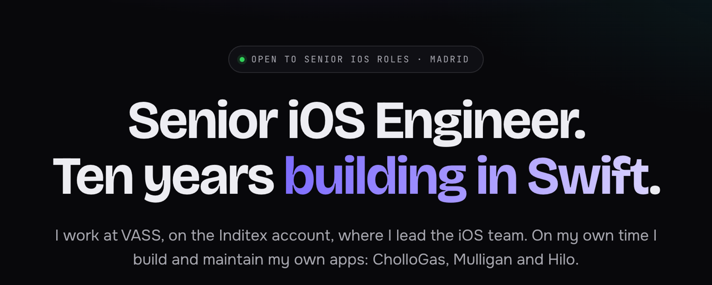
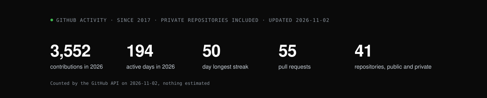
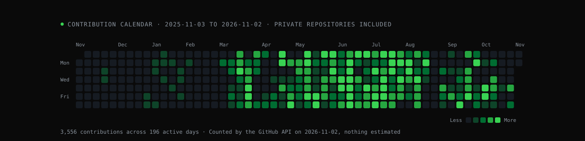
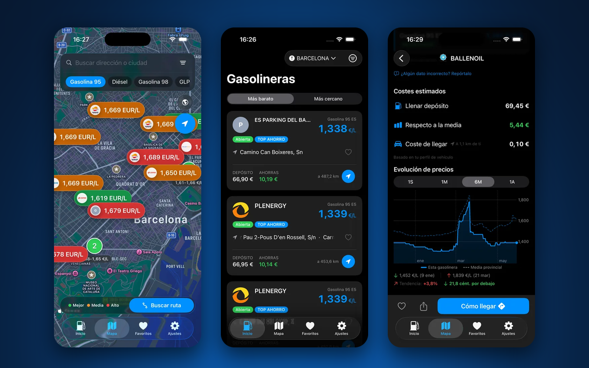
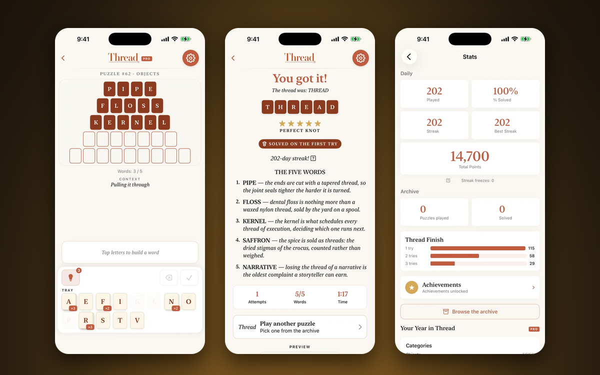
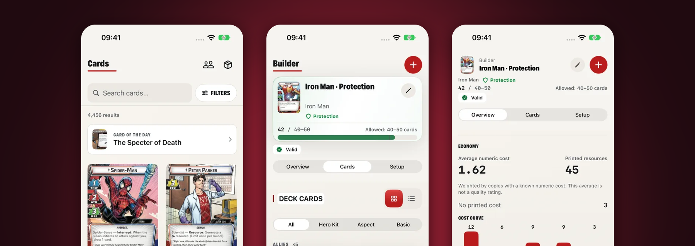
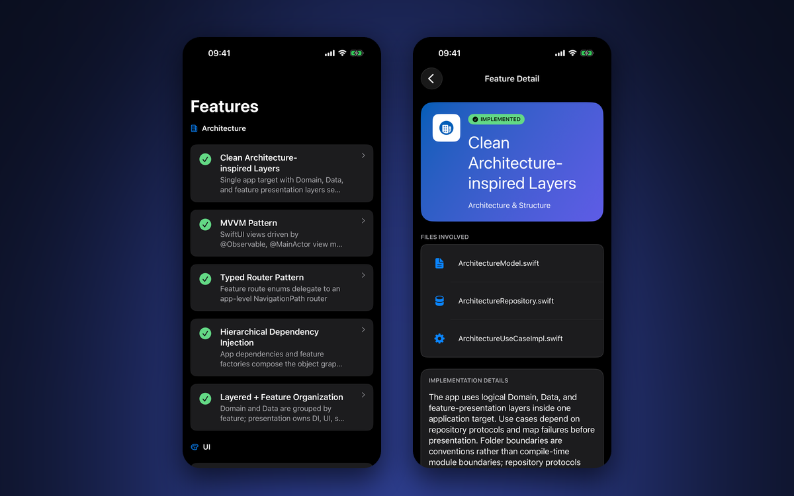
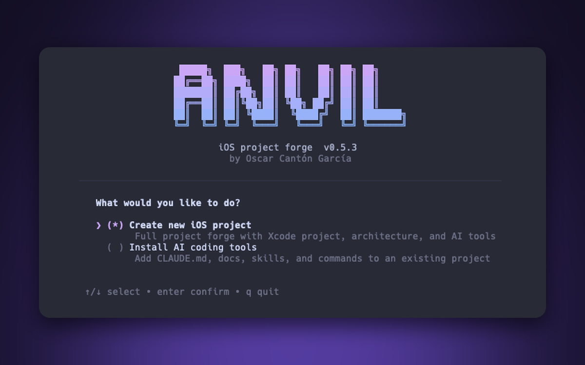
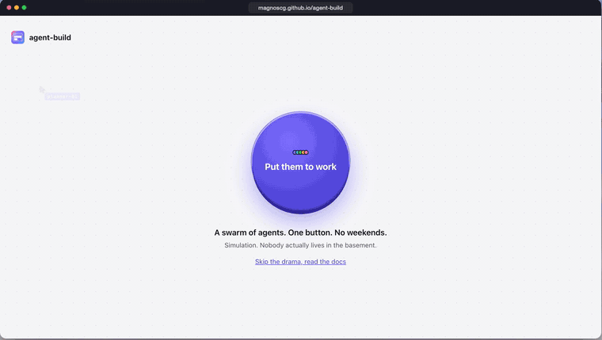

[**Portfolio**](https://ogamlabs.com) · [**LinkedIn**](https://www.linkedin.com/in/oscarcantongarcia/) · [**Contact**](mailto:soporte@ogamlabs.com)

## 👋 Hi, I'm Oscar

- 🏢 **Day job** — iOS team lead as a consultant. Since late 2022 I have been on the Inditex account, on the app that store staff across the group use every day, and since 2025 I lead its iOS team.
- 🏦 **Before that** — banking and retail client projects: Santander, Mercadona, Unicaja, Banco Pichincha.
- 🧪 **Own work** — signed as OgamLabs: three apps on the App Store, and I keep their API, their database and their server running myself.
- 💬 **Happy to talk about** — senior iOS work, leading a team, architecture, or developer tooling.

## Selected work

**📱 On the App Store**

<table>
<tr>
<td width="50%" valign="top">

### CholloGas

⛽ Swift, SwiftUI · TypeScript, Fastify, PostgreSQL

Fuel prices across Spain and France, from the official open data. I build the
app and operate its API. The public engineering case study covers the Swift 6
offline-first client, the official-data ingestion and the production operations
— without exposing the product source.

[Product site](https://chollogas.ogamlabs.com) ·
[App Store](https://apps.apple.com/es/app/chollogas-gasolineras-baratas/id6773014516) ·
[Engineering case study](https://github.com/magnoscg/chollogas-case-study)

</td>
<td width="50%" valign="top">

### Hilo

🧩 A published SwiftUI word game

Five words hiding one common thread, one short round a day.

4,015 original puzzles, 11 store locales, 1,128 passing tests. The long part was
not the game but the pipeline that generates, validates and reviews the
catalogue and the store assets.

[Product site](https://hilo.ogamlabs.com) ·
[App Store](https://apps.apple.com/es/app/id6779929637) ·
[Engineering case study](https://github.com/magnoscg/hilo-case-study)

</td>
</tr>
<tr>
<td colspan="2" valign="top">

### Mulligan

🃏 Swift 6, SwiftUI, GRDB · iPhone and iPad

A free, fan-made deck builder for Marvel Champions: browse the card catalogue,
build and validate decks, track the packs you own, read the rules and import
decks from the community, which runs on its own OgamLabs backend. Decks stay on
the device. English and Spanish, with more than 2,500 Swift Testing tests.

[Product site](https://mulligan.ogamlabs.com) ·
[App Store](https://apps.apple.com/app/id6808994619)

</td>
</tr>
</table>

**🧰 Open source**

<table>
<tr>
<td width="50%" valign="top">

### iOS Architecture Reference

🏗️ Swift 6, SwiftUI, Swift Testing

A real Xcode application that builds, not a diagram: a single app target
inspired by Clean Architecture, with MVVM, typed Router navigation and manual
factory-based dependency injection. 253 Swift Testing cases across 33 suites
hold the boundaries in place, with zero third-party package dependencies.

[Code and decisions](https://github.com/magnoscg/ios-architecture-reference) ·
[CI checks](https://github.com/magnoscg/ios-architecture-reference/actions/workflows/ci.yml)

</td>
<td width="50%" valign="top">

### AnvilCLI

⚒️ Go, Bubble Tea · generates Swift 6 projects

A Go CLI that sets up iOS projects with Clean Architecture, MVVM, Router
navigation and optional AI coding packs. Its transactional generator validates
every destination before it writes and never overwrites a file.
465 automated tests; its 34 provenance-tracked skills include
25 self-contained Swift 6 examples.

[Code and security](https://github.com/magnoscg/anvil) ·
[CI checks](https://github.com/magnoscg/anvil/actions/workflows/ci.yml)

</td>
</tr>
<tr>
<td colspan="2" valign="top">

### agent-build

🧱 TypeScript, Web Animations · no runtime dependencies

A library that pokes fun at the viral "20 AI agents built my site" videos. One
button hides the page and a simulated swarm of agent cursors rebuilds it, block
by block, then says it was a simulation. It runs under a strict Content Security
Policy with Trusted Types, in eight languages.

[Live demo](https://magnoscg.github.io/agent-build/) ·
[Code](https://github.com/magnoscg/agent-build) ·
[npm](https://www.npmjs.com/package/@magnoscg/agent-build)

</td>
</tr>
</table>

## AI-assisted engineering in development

Two tools I built because I needed them. Each has a public case study; the
tools themselves are not released yet.

<b>🤖 PRDPlanner and HarnessHub</b>

### PRDPlanner

A PRD → plan → build workflow with bounded context, dependency-aware phases,
parallel verification and a stage whose job is to refute what the other stages
found, before a human decides. A public edition is in preparation.

[Engineering case study](https://github.com/magnoscg/prdplanner-case-study)

### HarnessHub

A local-first composer for skills, subagents, plugins and MCPs that produces
reproducible multi-harness bundles without installing or executing anything it
packages. It is currently in local beta.

[Engineering case study](https://github.com/magnoscg/harnesshub-case-study)

## Engineering focus

| | Area | What I use |
| --- | --- | --- |
| 🍎 | **Apple platforms** | Swift 6, SwiftUI, UIKit, Observation, SwiftData, StoreKit 2, WidgetKit, App Intents |
| 🏛️ | **Architecture** | Clean Architecture, MVVM, Router/Coordinator, modular SPM packages, dependency injection |
| ✅ | **Quality** | Swift Testing, XCTest, strict concurrency, accessibility, performance profiling, CI/CD |
| 🧰 | **Product systems** | Go and TypeScript tooling, APIs, PostgreSQL, data pipelines, code generation, MCP servers, release automation |

I like simple designs, decisions written down with their cost, and tests that
protect behaviour rather than implementation.
